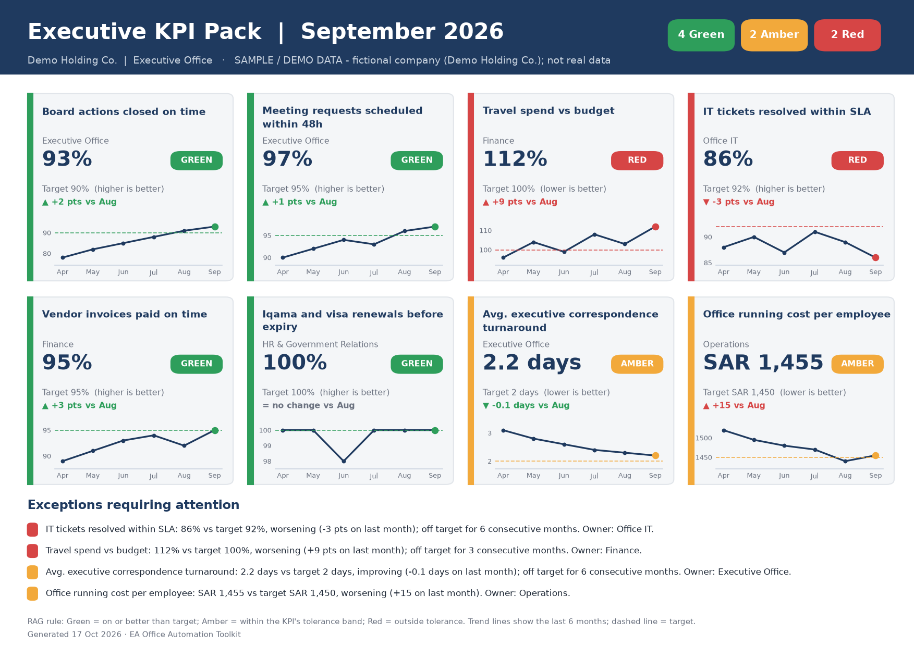
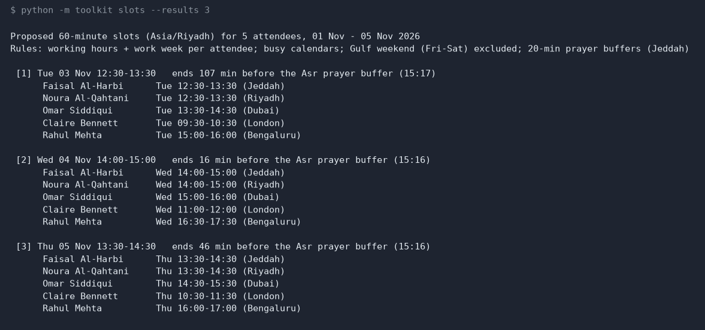
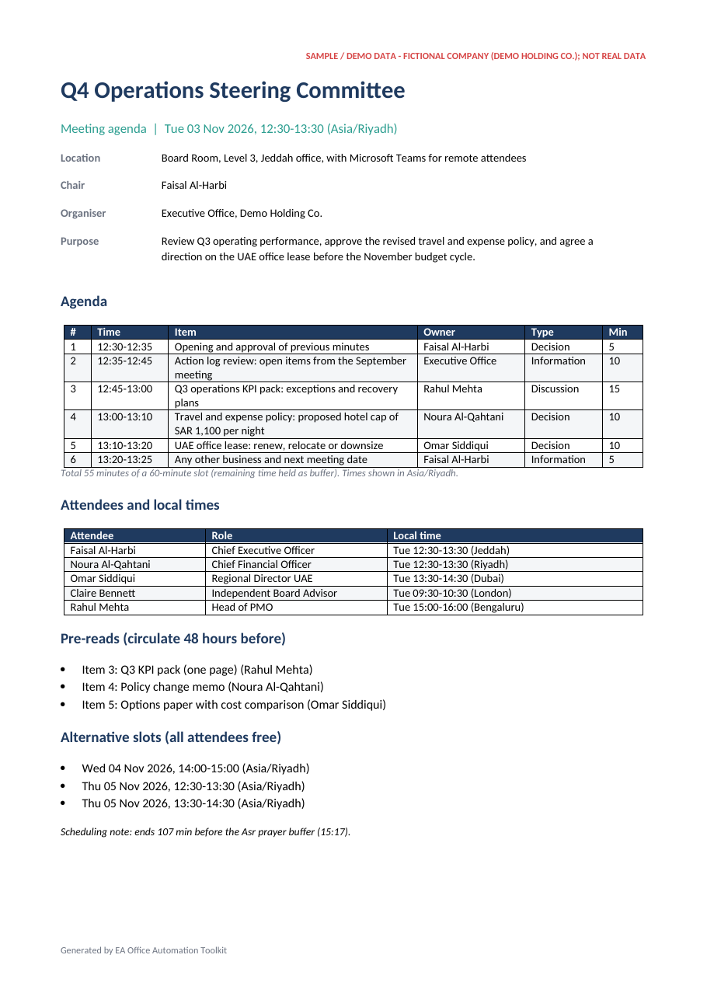
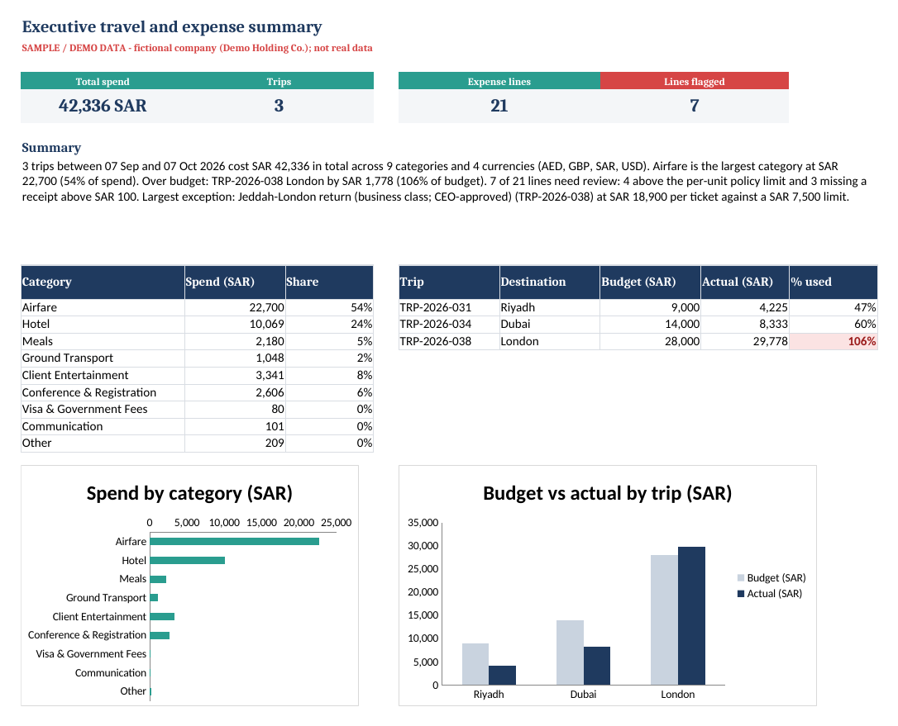
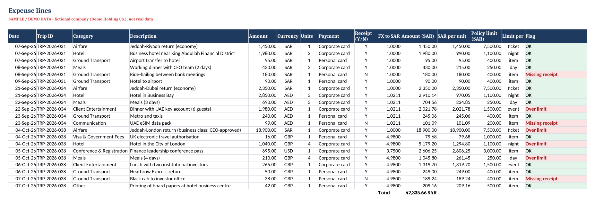
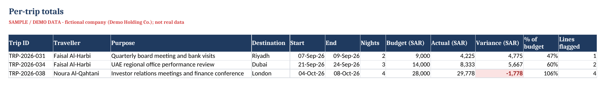

# EA Office Automation Toolkit


**Three Python tools that handle repetitive executive-office work: scheduling meetings across
time zones, tracking travel expenses in Excel, and producing a one-page KPI pack.** Built with
KSA/GCC working patterns in mind (Sun-Thu week, Fri-Sat weekend, Asia/Riyadh, prayer-time buffers).
It runs offline and **needs no Microsoft Office**. Outputs open in Word, Excel, Outlook and any PDF viewer.

> **All data in this repository is SAMPLE / DEMO DATA.** "Demo Holding Co." and everyone in it are
> fictional, and so are the trips, expenses and KPIs. Nothing here comes from a real company. See
> [`sample_data/README.md`](sample_data/README.md).



## Contents

- [The problem](#the-problem)
- [What it does](#what-it-does)
- [Quick start](#quick-start)
- [Command line](#command-line)
- [Outputs](#outputs)
- [How it works](#how-it-works)
- [Using your own data](#using-your-own-data)
- [Project layout](#project-layout)
- [Testing](#testing)
- [Limitations](#limitations)

## The problem

An executive office does a lot of the same work every week, and much of it is manual:

| Task | The manual way | What goes wrong |
|---|---|---|
| Find a time for 5 people in 4 time zones | Compare calendars by eye, convert time zones in your head | Missed weekend differences (Sun-Thu vs Mon-Fri), clashes with Dhuhr/Asr, back-and-forth emails |
| Write the agenda | Copy last meeting's Word file, retype the times | Item times don't add up to the slot, pre-reads get forgotten |
| Track trip expenses | Type receipts into a spreadsheet, convert currencies one by one | Policy breaches and missing receipts surface only at month-end |
| Prepare the monthly KPI pack | Build charts by hand in PowerPoint | Inconsistent RAG calls, no trend context, slow turnaround |

## What it does

**1. Meeting scheduler and agenda generator** (`slots`, `agenda`)
- Reads attendees (CSV) and busy times from **CSV and/or `.ics` calendar exports** (Outlook, Google, Apple)
- Applies each person's **local hours and work week** (e.g. Sun-Thu in KSA, Mon-Fri in UAE/UK/India)
- **Gulf weekend guard**: never proposes Friday or Saturday in the organiser's zone
- **Prayer-friendly buffers**: keeps Dhuhr, Asr and Maghrib free (Umm al-Qura convention; Jeddah, Riyadh, Dammam, Makkah, Dubai and Doha presets)
- Ranks slots by comfort (furthest from anyone's start or end of day) and spreads them across days
- Writes a timed agenda as **DOCX + Markdown (+ PDF)** with each attendee's local time, pre-reads and alternative slots, plus an **`.ics` invite**

**2. Expense / travel tracker** (`expenses`)
- Builds an **Excel workbook with live formulas**: FX conversion to SAR, per-unit policy limits (per night/day/ticket), flags, per-trip `SUMIFS`
- **Multi-currency** (SAR, USD, AED, GBP, EUR; rates in a table you control)
- **Policy flags**: over limit, and missing receipt above SAR 100 (conditional formatting, drop-down validation)
- **Summary sheet** with headline tiles, category and budget-vs-actual tables, **two native Excel charts** and an auto-written paragraph, plus `expense_summary.md`

**3. KPI pack generator** (`kpi`)
- Reads a tidy KPI CSV (one row per KPI per month)
- **RAG status** from target, direction (higher/lower is better) and a per-KPI tolerance band
- One-page **A4 PDF + PNG**: 8 tiles with 6-month trend lines, month-on-month change, and an **exceptions panel written automatically** ("off target for 3 consecutive months")

## Quick start

```bash
git clone https://github.com/amirator/ea-office-automation-toolkit.git
cd ea-office-automation-toolkit
make demo        # creates .venv, installs pinned deps, runs all three tools on the sample data
```

Without `make` (Windows):

```bash
python -m venv .venv
.venv\Scripts\activate            # macOS/Linux: source .venv/bin/activate
pip install -r requirements.txt
python -m toolkit demo
```

Results are written to `outputs/`. PDF export of the agenda uses LibreOffice if it is installed. Without it you still get the DOCX, Markdown and `.ics` files.

## Command line

```text
python -m toolkit {slots,agenda,expenses,kpi,demo} [options]
```



| Command | Key options | Output |
|---|---|---|
| `slots` | `--attendees` `--busy` `--ics "Name=file.ics"` `--start` `--end` `--duration` `--tz` `--prayer-city` `--prayer-buffer` `--no-gulf-weekend` `--results` | Ranked slots, printed with each attendee's local time |
| `agenda` | all `slots` options + `--brief` `--pick N` `--pdf` `--out` | `agenda_<date>.docx/.md/.ics` (+ `.pdf`) |
| `expenses` | `--expenses` `--trips` `--rates` `--policy` `--out` | `expense_tracker.xlsx`, `expense_summary.md` |
| `kpi` | `--csv` `--period YYYY-MM` `--out` | `kpi_pack_<period>.pdf/.png` |
| `demo` | `--out` | All of the above, from `sample_data/` |

Examples:

```bash
# 45-minute slots in the week of 1 Nov, Riyadh prayer times, 15-minute buffers
python -m toolkit slots --start 2026-11-01 --end 2026-11-05 --duration 45 --prayer-city riyadh --prayer-buffer 15

# Build the agenda for the second proposed slot, with PDF
python -m toolkit agenda --pick 2 --pdf

# KPI pack for an earlier month
python -m toolkit kpi --period 2026-08
```

Every command defaults to the bundled sample files, so each one runs with no arguments. Add `--real` to drop the SAMPLE banner when you run it on your own data.

## Outputs

These screenshots show the actual files `make demo` produced, rendered by `scripts/make_screenshots.py`. They are not mock-ups.

| Agenda (DOCX → PDF) | Expense summary sheet (Excel) |
|---|---|
|  |  |

**Expense lines.** The flags come from live Excel formulas: over the per-unit limit, or missing a receipt above SAR 100.



**Per-trip totals.** `SUMIFS` budget vs actual, with negative variance highlighted.



Text summary written for the sample data (from `outputs/expenses/expense_summary.md`):

> 3 trips between 07 Sep and 07 Oct 2026 cost SAR 42,336 in total across 9 categories and 4 currencies (AED, GBP, SAR, USD). Airfare is the largest category at SAR 22,700 (54% of spend). Over budget: TRP-2026-038 London by SAR 1,778 (106% of budget). 7 of 21 lines need review: 4 above the per-unit policy limit and 3 missing a receipt above SAR 100.

## How it works

```text
sample_data/*.csv|.ics|.json ──► loaders (toolkit/common.py, ics.py)
                                   │
        ┌──────────────────────────┼───────────────────────────┐
  scheduler.py + prayer.py     expenses.py                   kpi.py
  slot search & ranking        Python totals + openpyxl      RAG + matplotlib
        │                      workbook with live formulas   one-page layout
  agenda.py (python-docx)            │                            │
        ▼                            ▼                            ▼
  .docx .md .pdf .ics          .xlsx + .md                  .pdf + .png
```

- **Time zones** use the standard-library `zoneinfo`, so daylight-saving changes (e.g. London in late October) are handled correctly.
- **Slot search** walks the window in 15-minute steps in the organiser's zone. It rejects any slot outside someone's local working day, on their weekend, overlapping a busy block or a prayer buffer, then scores the rest by the smallest margin to anyone's day edge.
- **Prayer times** are calculated from solar position (Fajr 18.5°, Asr shadow factor 1, Isha = Maghrib + 90 min, the Umm al-Qura convention). They come within a few minutes of published timetables, which is good enough for scheduling buffers. For the actual adhan, follow the official local timetable.
- **The workbook keeps formulas** rather than pasted values, so finance can add lines and everything recalculates. The same figures are computed in Python for the text summary and the tests.
- **The ICS reader** has no dependencies and handles folded lines, `TZID`, UTC (`Z`), floating and all-day events, and skips cancelled or free events.

## Using your own data

Copy a sample file, keep the header row, and replace the rows. Lines that start with `#` are ignored.

| File | Required columns |
|---|---|
| attendees | `name, role, email, timezone, city, work_start, work_end, work_days` (e.g. `Asia/Riyadh, 08:00, 17:00, Sun-Thu`) |
| busy | `attendee, start, end, title` (ISO 8601, e.g. `2026-11-02T12:30:00+03:00`) |
| meeting brief | JSON: `title, chair, organiser, location, purpose, items[{topic, owner, minutes, type, pre_read}]` |
| expenses | `date, trip_id, category, description, amount, currency, units, payment_method, receipt` |
| trips | `trip_id, traveller, purpose, destination, start_date, end_date, budget_sar` |
| fx_rates / policy | `currency, sar_per_unit` / `category, limit_sar, per, notes` |
| kpis | `kpi, function, unit, direction, amber_tolerance_pct, period, actual, target` |

Bad input gets a plain error message, for example `error: Row 7: no FX rate for currency JPY`.

## Project layout

```text
toolkit/            package (python -m toolkit)
  cli.py            argparse sub-commands
  scheduler.py      slot search across zones / work weeks
  prayer.py         prayer-time calculation for buffers
  ics.py            .ics reader + invite writer
  agenda.py         DOCX / Markdown / PDF agenda
  expenses.py       Excel tracker + summary
  kpi.py            one-page KPI pack
sample_data/        fictional demo inputs (clearly labelled)
tests/              pytest suite (24 tests)
scripts/            make_screenshots.py
docs/               README screenshots of real outputs
```

## Testing

```bash
make test           # or: python -m pytest -q
```

The tests cover work-week parsing, Gulf weekend and time-zone boundaries, busy and prayer-buffer
avoidance, the "no possible slot" case, ICS parsing, FX conversion, policy and receipt flags, totals
reconciliation, workbook structure and formulas, RAG thresholds, KPI rendering, and a full
end-to-end `demo` run. A GitHub Actions workflow is set up to run them on Ubuntu and Windows with Python 3.12 and 3.13.

## Limitations

- Prayer times are approximate (within a few minutes). They are meant for buffers, not for worship.
- FX rates are whatever you put in `fx_rates.csv`. Nothing is fetched live.
- The scheduler treats every attendee as required. It does not yet support optional attendees or room booking.
- The KPI layout is designed for up to 8 KPIs on one page.

## Author

Mohammad Amir Khan, Executive Assistant / Office Manager, Jeddah · [github.com/amirator](https://github.com/amirator) · [linkedin.com/in/amir-khan-a31363235](https://www.linkedin.com/in/amir-khan-a31363235/)

MIT licensed.
